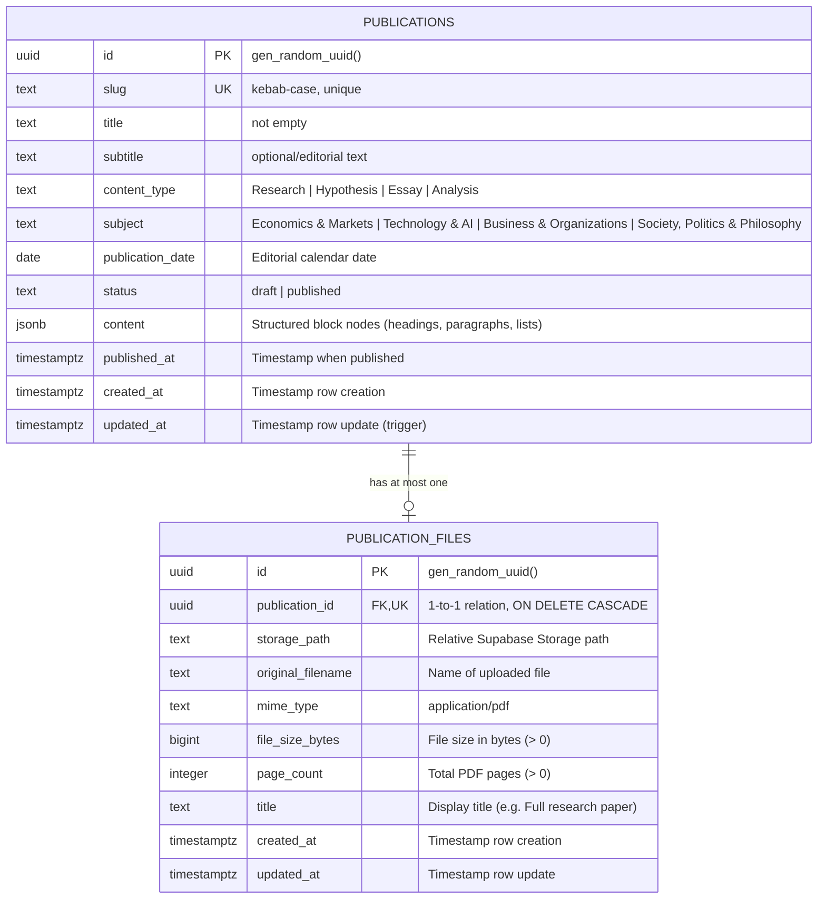
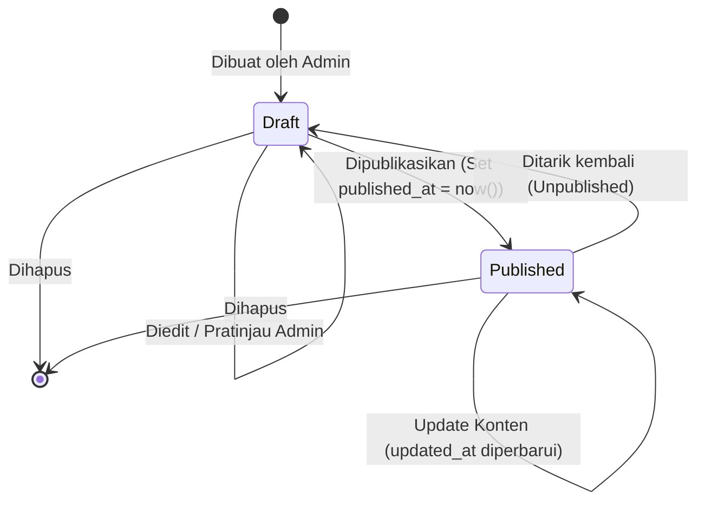

# Dokumentasi Rancangan Database Supabase — Personal Publication Website

> **Status Dokumen:** DRAFT / REVIEW ONLY  
> **Fase Proyek:** Phase 4 — Supabase Database Design  
> **Tanggal:** 2026-10-20  
> **Penulis:** Antigravity AI Assistant  
> **Target Database:** PostgreSQL 15+ (Supabase)  
> **Pemberitahuan:** Dokumen ini merupakan rancangan arsitektural dan spesifikasi skema database. **Tidak ada migrasi atau modifikasi yang diterapkan pada database aktif pada fase ini.**

---

## 1. Ringkasan Hasil Audit Struktur Frontend

Sebelum merancang skema database, telah dilakukan audit menyeluruh terhadap kode implementasi frontend (Phase 1, Phase 2, dan Phase 3):

### A. Tinjauan File Aktual
1. **`lib/mock-publications.ts`**:
   - Menetapkan tipe kategori publikasi (`ContentType`): `'Research' | 'Hypothesis' | 'Essay' | 'Analysis'`.
   - Menetapkan urutan tampilan beranda (`ORDERED_CONTENT_TYPES`): urutan tetap `['Research', 'Hypothesis', 'Essay', 'Analysis']`.
   - Menetapkan subjek bidang (`Subject`):
     - `'Economics & Markets'`
     - `'Technology & AI'`
     - `'Business & Organizations'`
     - `'Society, Politics & Philosophy'`
   - Struktur antarmuka `Publication`:
     - `id`: string (misal `'pub-1'`).
     - `slug`: string (kebab-case URL identifier).
     - `title`: string (judul artikel).
     - `subtitle`: string (subjudul / deskripsi pendek).
     - `contentType`: `ContentType`.
     - `subject`: `Subject`.
     - `publishedAt`: string ISO 8601 timestamp (misal `'2025-01-20T00:00:00Z'`).
     - `readingTimeMinutes`: opsional number.
     - `contentHtml`: opsional string HTML mentah.
     - `introParagraphs`: opsional `string[]` untuk paragraf pembuka.
     - `sections`: opsional array `ArticleSection[]` yang terdiri dari `{ id, title, subtitle?, paragraphs: string[] }`.
     - `pdfAttachment`: opsional objek `{ url, filename, title?, pageCount?, fileSizeBytes?, fileSizeDisplay? }`.

2. **`app/page.tsx` (Homepage)**:
   - Mengambil data melalui `getPublicationsGroupedByType()`.
   - Mengelompokkan publikasi berdasarkan 4 `ORDERED_CONTENT_TYPES`.
   - Setiap publikasi ditampilkan melalui komponen `PublicationItem`.

3. **`components/publications/PublicationItem.tsx`**:
   - Menampilkan `subject` (font serif accent).
   - Menampilkan `title` sebagai tautan ke `/publications/${publication.slug}`.
   - Menampilkan `subtitle` (font serif secondary text).

4. **`app/publications/[slug]/page.tsx` (Halaman Detail)**:
   - Menjalankan pencarian publikasi berdasarkan `slug`.
   - Mengisi Next.js `generateMetadata` dengan format:
     - `title`: `${publication.title} — Reyhana Izzal`
     - `description`: `publication.subtitle`
   - Melempar `notFound()` jika publikasi tidak ditemukan.

5. **`components/publications/PublicationDetailLayout.tsx` & `TableOfContents.tsx`**:
   - Membangun Table of Contents (TOC) dari `introParagraphs` (id `'introduction'`) dan setiap item dalam `sections` (`{ id: section.id, title: section.title }`).
   - Menyediakan navigasi scroll-spy menggunakan `IntersectionObserver` yang mengaitkan heading dengan anchor ID yang stabil.
   - Menampilkan `formattedDate` (`new Date(publishedAt).toLocaleDateString('en-US', { month: 'long', day: 'numeric', year: 'numeric' })`).
   - Menampilkan blok lampiran PDF jika `publication.pdfAttachment` tersedia.

6. **`components/publications/PdfAttachmentBox.tsx`**:
   - Menampilkan box lampiran PDF dengan judul (default `'Full research paper (PDF)'`), jumlah halaman (`pageCount` atau default `'45 pages'`), dan ukuran berkas (`fileSizeDisplay` atau format MB dari `fileSizeBytes`).
   - Menyediakan tombol unduh (`download`) dan tombol baca langsung tab baru (`target="_blank"`).

7. **Status Dependensi & Konfigurasi**:
   - `package.json` telah menyertakan `@supabase/supabase-js` (^2.118.0) dan `@supabase/ssr` (^0.12.7).
   - Tidak ada kode runtime frontend yang saat ini terhubung ke database Supabase (seluruh tampilan masih murni mengonsumsi mock data).

---

## 2. Kebutuhan Data dan Asumsi Arsitektur

Berdasarkan audit di atas, disusun prinsip-prinsip arsitektural berikut:

1. **Pemisahan Data Editorial dan Sistem**:
   - Tanggal editorial publikasi (`publication_date`) harus dibedakan dari waktu teknis pembuatan baris (`created_at`), pembaruan baris (`updated_at`), dan momen perubahan status menjadi publik (`published_at`).
2. **Integritas Draft vs Published**:
   - Database harus menjamin secara absolut pada level PostgreSQL RLS bahwa publikasi berstatus `draft` **tidak akan pernah bisa di-query atau bocor kepada publik visitor**, tanpa bergantung pada filter query frontend (`WHERE status = 'published'`).
3. **Penyimpanan Dokumen Konten Terstruktur**:
   - Format HTML mentah rentan terhadap XSS jika tidak disanitasi dan kaku untuk diekstraksi ke TOC. Konten artikel dirancang menggunakan format `jsonb` terstruktur dengan skema blok hierarki. Format ini siap dihubungkan dengan editor modern (seperti Tiptap/ProseMirror/Lexical) pada Phase 6 (Admin/CMS).
4. **Kebijakan Lampiran PDF**:
   - Setiap publikasi memiliki batasan **maksimal satu file PDF opsional**.
   - Metadata file dipisahkan ke tabel khusus (`publication_files`) untuk fleksibilitas manajemen file dan integritas relasional, dengan `UNIQUE` constraint pada foreign key `publication_id`.
   - File fisik disimpan di Supabase Storage (bukan byte BLOB di dalam database). Path yang disimpan di database adalah storage object key relatif, bukan URL publik absolut.
5. **Kesesuaian Identitas Administrator**:
   - Administrator tidak boleh ditentukan semata-mata dari status login (`auth.role() = 'authenticated'`). Administrator harus diverifikasi melalui claim aman pada JWT (`app_metadata`) atau tabel mapping admin khusus.

---

## 3. Diagram Relasi Tabel (ERD)



---

## 4. Deskripsi Detail Tabel & Field

### A. Tabel `publications`

Tabel utama yang menyimpan seluruh data publikasi, konten artikel, dan status penerbitan.

| Nama Kolom | Tipe Data | Nullable | Nilai Default / Constraint | Deskripsi & Justifikasi |
|---|---|---|---|---|
| `id` | `uuid` | **NOT NULL** | `gen_random_uuid()` | Primary Key stabil berstandar UUID. Menghindari enumerasi berurutan dan siap untuk arsitektur terdistribusi. |
| `slug` | `text` | **NOT NULL** | `UNIQUE` | URL slug unik untuk routing `/publications/[slug]`. Divalidasi format lowercase kebab-case. |
| `title` | `text` | **NOT NULL** | `CHECK (length(trim(title)) > 0)` | Judul publikasi. Tidak boleh string kosong atau hanya spasi. |
| `subtitle` | `text` | NULL | Tidak ada | Subjudul / deskripsi pendek artikel. Berdasarkan audit frontend, subtitle ditampilkan pada kartu beranda, heading detail, dan metadata. Dibuat nullable di database agar fleksibel jika ada publikasi singkat tanpa subjudul, namun direkomendasikan diisi di CMS. |
| `content_type` | `text` | **NOT NULL** | `CHECK (...)` | Kategori publikasi. Nilai dibatasi: `'Research'`, `'Hypothesis'`, `'Essay'`, `'Analysis'`. |
| `subject` | `text` | **NOT NULL** | `CHECK (...)` | Bidang keilmuan. Nilai dibatasi: `'Economics & Markets'`, `'Technology & AI'`, `'Business & Organizations'`, `'Society, Politics & Philosophy'`. |
| `publication_date` | `date` | **NOT NULL** | `CURRENT_DATE` | Tanggal editorial rilis (misal `2025-01-20`). Menggunakan tipe `date` murni (tanpa waktu/zona waktu) untuk menghindari pergeseran tanggal saat dibaca di berbagai zona waktu dunia (UTC vs GMT+7). |
| `status` | `text` | **NOT NULL** | `'draft'` | Status siklus hidup artikel. Dibatasi: `'draft'` atau `'published'`. Default `'draft'` menjamin artikel baru tidak langsung tampil ke publik tanpa sengaja. |
| `content` | `jsonb` | **NOT NULL** | `'{"type":"doc","sections":[]}'::jsonb` | Konten artikel terstruktur (rich-text blocks). Menyimpan blok paragraf dan heading lengkap dengan ID stabil untuk TOC. |
| `published_at` | `timestamptz` | NULL | Tidak ada | Timestamp presisi kapan publikasi pertama kali (atau terakhir kali) diaktifkan statusnya menjadi `'published'`. NULL ketika berstatus `'draft'`. |
| `created_at` | `timestamptz` | **NOT NULL** | `now()` | Waktu pembuatan record di database. Selalu berzona waktu (`timestamptz`). |
| `updated_at` | `timestamptz` | **NOT NULL** | `now()` | Waktu modifikasi terakhir record di database. Diperbarui otomatis melalui database trigger. |

### B. Tabel `publication_files`

Tabel untuk menyimpan metadata file PDF lampiran yang tersimpan di Supabase Storage.

| Nama Kolom | Tipe Data | Nullable | Nilai Default / Constraint | Deskripsi & Justifikasi |
|---|---|---|---|---|
| `id` | `uuid` | **NOT NULL** | `gen_random_uuid()` | Primary Key untuk record file. |
| `publication_id` | `uuid` | **NOT NULL** | `UNIQUE`, `REFERENCES publications(id) ON DELETE CASCADE` | Kunci relasi ke publikasi. Constraint `UNIQUE` menjamin secara mutlak bahwa **satu publikasi hanya memiliki maksimal satu file PDF**. `ON DELETE CASCADE` memastikan jika publikasi dihapus, record file metadata ikut terhapus. |
| `storage_path` | `text` | **NOT NULL** | `CHECK (length(trim(storage_path)) > 0)` | Lokasi path objek di Supabase Storage bucket (misal: `publications/pub-uuid/research-paper.pdf`). Bukan URL absolut. |
| `original_filename` | `text` | **NOT NULL** | `CHECK (length(trim(original_filename)) > 0)` | Nama file asli saat diunggah (misal: `market-valuation-models.pdf`), digunakan untuk atribut `download` pada tombol unduh. |
| `mime_type` | `text` | **NOT NULL** | `CHECK (mime_type = 'application/pdf')` | Memastikan file yang dilampirkan bertipe MIME PDF. |
| `file_size_bytes` | `bigint` | **NOT NULL** | `CHECK (file_size_bytes > 0)` | Ukuran berkas dalam bytes. Tipe `bigint` mendukung ukuran file besar tanpa risiko integer overflow. |
| `page_count` | `integer` | NULL | `CHECK (page_count > 0)` | Estimasi jumlah halaman dokumen (sesuai field `pageCount` pada komponen `PdfAttachmentBox`). |
| `title` | `text` | NULL | Tidak ada | Judul tampilan custom untuk box PDF (misal: `'Full research paper (PDF)'`). Jika NULL, frontend dapat fallback ke default. |
| `created_at` | `timestamptz` | **NOT NULL** | `now()` | Waktu pencatatan file di database. |
| `updated_at` | `timestamptz` | **NOT NULL** | `now()` | Waktu modifikasi metadata file terakhir (diperbarui via trigger). |

---

## 5. Analisis Mendalam: PostgreSQL ENUM vs TEXT CHECK Constraint

Untuk membatasi nilai pada `content_type`, `subject`, dan `status`, terdapat dua pendekatan standar di PostgreSQL. Berikut perbandingannya:

### Perbandingan Karakteristik

| Aspek | PostgreSQL Custom ENUM (`CREATE TYPE ... AS ENUM`) | TEXT dengan CHECK Constraint (`CHECK (col IN (...))`) |
|---|---|---|
| **Penyimpanan Internal** | 4 byte per nilai enum terlepas dari panjang teks. | 1 byte overhead + panjang string byte sebenarnya. |
| **Kemudahan Modifikasi Nilai Baru** | Memerlukan `ALTER TYPE content_type_enum ADD VALUE 'NewCategory'`. Pada versi PG sebelum PG12 tidak dapat dijalankan di dalam blok transaksi (`BEGIN ... COMMIT`). | Sangat mudah: Cukup `ALTER TABLE ... DROP CONSTRAINT` lalu `ADD CONSTRAINT` di dalam satu transaksi migrasi standar yang aman. |
| **Kemudahan Menghapus / Mengubah Nilai** | Sangat sulit. PostgreSQL **tidak mendukung** `DROP VALUE` atau mengubah nama nilai enum tanpa membuat enum baru, memindahkan kolom, dan menghapus tipe lama. | Sangat fleksibel. Nilai lama dapat di-update dengan `UPDATE table SET col = 'New' WHERE col = 'Old'` kemudian constraint diperbarui dalam satu migrasi. |
| **Kompatibilitas Tooling & ORM** | Memerlukan mapping tipe custom pada beberapa tool/generator TypeScript. Terkadang menghasilkan konflik namespace tipe. | Dianggap sebagai tipe `string` standar oleh seluruh driver, Supabase client, PostgREST, dan TypeScript generator. |
| **Portabilitas & Dump/Restore** | Tipe tersimpan di catalog `pg_type` terpisah. Saat mengekspor skema parsial, definisi tipe harus selalu disertakan. | Definisi constraint menyatu di dalam definisi tabel (self-contained). |

### Rekomendasi untuk Proyek Ini: **TEXT dengan CHECK Constraint**

**Alasan Pemilihan:**
1. **Fleksibilitas Evolusi Taksonomi**: Walaupun saat ini terdapat 4 Content Types dan 4 Subjects yang baku, website publikasi personal berada dalam tahap pengembangan aktif. Di masa depan mungkin terdapat penyesuaian penamaan (misalnya `'Society, Politics & Philosophy'` diubah atau disederhanakan). Menggunakan `TEXT` dengan `CHECK` constraint memungkinkan penyesuaian tanpa migrasi yang merusak (zero-downtime transactional migration).
2. **Kesesuaian dengan Supabase Best Practices**: Panduan resmi Supabase (`schema-data-types.md`) merekomendasikan `text with check constraint` untuk kasus nilai enumerasi yang mungkin berkembang, karena kompatibilitasnya yang tinggi dengan PostgREST API dan migrasi deklaratif.
3. **Volume Data**: Untuk skala website publikasi personal (ratusan hingga ribuan artikel), perbedaan 4 byte versus belasan byte teks sama sekali tidak memiliki dampak performa atau kapasitas penyimpanan, sedangkan fleksibilitas operasional yang didapat sangat berharga.

---

## 6. Desain Structured Rich-Text Content (`jsonb`) & Integrasi TOC

### A. Evaluasi Format Penyimpanan Konten
- **HTML Mentah (`content_html text`)**:
  - *Risiko:* Kerentanan XSS (Cross-Site Scripting) jika disuntikkan langsung melalui `dangerouslySetInnerHTML`.
  - *Kelemahan:* Sangat sulit mengekstrak heading dan ID secara terstruktur untuk membangun Table of Contents (TOC) di server tanpa HTML parser yang berat.
- **Markdown Mentah (`content_md text`)**:
  - *Kelebihan:* Portabel dan mudah dibaca manusia.
  - *Kelemahan:* Membutuhkan parsing AST (Abstract Syntax Tree) berulang pada runtime setiap kali halaman dirender untuk mendapatkan daftar heading dan ID scroll-spy.
- **Structured JSON (`content jsonb`) — PILIHAN TERBAIK**:
  - *Keunggulan:* Mendukung parsing langsung di server/client, schema-validation, aman dari injeksi script mentah, dan memetakan struktur heading level 2/3 langsung ke komponen `TableOfContents` yang sudah ada pada Phase 3.
  - Sesuai dengan format output standar editor modern seperti **Tiptap**, **ProseMirror**, atau **Editor.js**.

### B. Spesifikasi Skema JSON

Struktur `jsonb` dirancang agar secara langsung kompatibel dengan kebutuhan frontend yang diaudit (`introParagraphs`, `sections`, heading IDs untuk TOC, subtitle section, paragraf, list, dan link):

```json
{
  "version": 1,
  "intro": [
    "Dario Amodei is the CEO of Anthropic, a public benefit corporation dedicated to building AI systems that are steerable, interpretable and safe.",
    "Previously, Dario served as Vice President of Research at OpenAI..."
  ],
  "sections": [
    {
      "id": "surprising-empowerment",
      "level": 2,
      "title": "1. A surprising and terrible empowerment",
      "subtitle": "Misuse for destruction",
      "blocks": [
        {
          "type": "paragraph",
          "content": "Let’s suppose that the problems of AI autonomy have been solved..."
        },
        {
          "type": "paragraph",
          "content": "Under this assumption, who has access to the AI geniuses, and what do they want to do with them?"
        },
        {
          "type": "heading",
          "level": 3,
          "id": "biological-threats",
          "title": "Biological threats and proliferation",
          "blocks": [
            {
              "type": "paragraph",
              "content": "Detailed analysis regarding the proliferation of dual-use biological technologies..."
            }
          ]
        },
        {
          "type": "list",
          "style": "bullet",
          "items": [
            "Advanced synthesis screening protocols",
            "Hardware-level telemetry safeguards"
          ]
        }
      ]
    },
    {
      "id": "quantitative-analysis",
      "level": 2,
      "title": "2. Quantitative analysis of valuation trajectories",
      "subtitle": "Statistical modeling of long-term equilibria",
      "blocks": [
        {
          "type": "paragraph",
          "content": "When we apply rigorous statistical frameworks across century-scale asset returns..."
        }
      ]
    }
  ]
}
```

### C. Mekanisme Pembuatan Heading ID yang Stabil untuk TOC
1. Setiap section/heading memiliki atribut `id` yang dihasilkan secara deterministik saat konten dibuat (slugify dari teks judul, misal `"1. A surprising and terrible empowerment"` -> `"surprising-empowerment"`).
2. Properti `id` ini menjadi anchor HTML di frontend: `<section id={section.id}>` atau `<h2 id={section.id}>`.
3. Komponen `TableOfContents` di frontend langsung memetakan `sections.map(s => ({ id: s.id, title: s.title }))`.
4. `IntersectionObserver` menggunakan elemen dengan ID tersebut untuk mengubah status active item TOC saat pembaca menggulir halaman.

---

## 7. Constraint dan Integritas Database

Database harus menjadi garda terdepan integritas data (data integrity gatekeeper) yang independen dari validasi frontend.

### A. Daftar Constraint yang Diterapkan

1. **Primary Key Constraints**:
   - `pk_publications`: `PRIMARY KEY (id)` pada tabel `publications`.
   - `pk_publication_files`: `PRIMARY KEY (id)` pada tabel `publication_files`.
2. **Unique Constraints**:
   - `uq_publications_slug`: `UNIQUE (slug)` memastikan tidak ada dua artikel dengan URL slug yang sama.
   - `uq_publication_files_publication_id`: `UNIQUE (publication_id)` memastikan aturan **maksimal 1 PDF per publikasi**.
3. **Foreign Key Constraint**:
   - `fk_publication_files_publication`: `FOREIGN KEY (publication_id) REFERENCES publications(id) ON DELETE CASCADE`. Jika artikel dihapus, referensi file ikut terhapus bersih.
4. **Value & Format Check Constraints**:
   - `chk_publications_slug_format`: `CHECK (slug ~ '^[a-z0-9]+(?:-[a-z0-9]+)*$')` — menjamin format kebab-case bersih (hanya huruf kecil, angka, dan tanda hubung tunggal).
   - `chk_publications_title_not_empty`: `CHECK (length(trim(title)) > 0)` — mencegah judul kosong atau hanya berisi spasi.
   - `chk_publications_subtitle_not_empty`: `CHECK (subtitle IS NULL OR length(trim(subtitle)) > 0)` — jika diisi, tidak boleh hanya spasi.
   - `chk_publications_content_type`:
     ```sql
     CHECK (content_type IN ('Research', 'Hypothesis', 'Essay', 'Analysis'))
     ```
   - `chk_publications_subject`:
     ```sql
     CHECK (subject IN (
       'Economics & Markets',
       'Technology & AI',
       'Business & Organizations',
       'Society, Politics & Philosophy'
     ))
     ```
   - `chk_publications_status`:
     ```sql
     CHECK (status IN ('draft', 'published'))
     ```
   - `chk_publications_status_published_at_consistency`:
     ```sql
     CHECK (
       (status = 'draft') OR 
       (status = 'published' AND published_at IS NOT NULL)
     )
     ```
     Menjamin bahwa setiap artikel yang berstatus `'published'` wajib memiliki timestamp `published_at`.
   - `chk_publication_files_mime_type`: `CHECK (mime_type = 'application/pdf')` — membatasi hanya berkas PDF.
   - `chk_publication_files_file_size`: `CHECK (file_size_bytes > 0)` — ukuran file harus bernilai positif.
   - `chk_publication_files_page_count`: `CHECK (page_count IS NULL OR page_count > 0)` — jumlah halaman harus positif jika dicatat.

---

## 8. Strategi Indeks & Optimasi Query

Penerapan indeks disusun berdasarkan prinsip performa Supabase (`query-missing-indexes.md`, `query-partial-indexes.md`, dan `schema-foreign-key-indexes.md`).

### A. Rationale & Daftar Indeks

1. **`publications_slug_key` (Otomatis)**:
   - Dibuat otomatis oleh constraint `UNIQUE (slug)`.
   - Query yang dioptimasi: `SELECT * FROM publications WHERE slug = :slug`.
2. **`idx_publications_published_listing` (Partial Index)**:
   ```sql
   CREATE INDEX idx_publications_published_listing 
   ON publications (publication_date DESC, created_at DESC) 
   WHERE status = 'published';
   ```
   - **Justifikasi (Supabase Best Practice):** Lebih dari 90% query publik membaca daftar publikasi yang sudah terbit diurutkan berdasarkan tanggal terbaru. Pengunjung tidak pernah melihat draft. Partial index ini berukuran jauh lebih kecil, hemat memori RAM, dan sangat cepat saat write operasi draft karena draft tidak dimasukkan ke dalam b-tree index ini.
3. **`idx_publications_published_content_type` (Partial Composite Index)**:
   ```sql
   CREATE INDEX idx_publications_published_content_type 
   ON publications (content_type, publication_date DESC) 
   WHERE status = 'published';
   ```
   - **Justifikasi:** Homepage mengelompokkan publikasi berdasarkan `content_type` (`Research`, `Hypothesis`, `Essay`, `Analysis`). Indeks komposit ini melayani query pengelompokan beranda secara instan (Index Only Scan).
4. **`idx_publication_files_publication_id` (Foreign Key Index)**:
   ```sql
   CREATE INDEX idx_publication_files_publication_id 
   ON publication_files (publication_id);
   ```
   - **Justifikasi (Supabase Best Practice):** PostgreSQL **tidak secara otomatis** mengindeks kolom foreign key. Tanpa indeks ini, operasi `JOIN` antara `publications` dan `publication_files` serta operasi `DELETE CASCADE` pada publikasi akan memicu sequential full table scan.

---

## 9. Row Level Security (RLS) & Access Control Matrix

Keamanan data diproteksi langsung di lapisan basis data menggunakan PostgreSQL Row Level Security (RLS). Seluruh tabel wajib mengaktifkan RLS (`ENABLE ROW LEVEL SECURITY`).

### A. Matriks Kebijakan Akses

| Tabel | Aktor (Role) | Operasi | Kebijakan (Policy) | Logika SQL |
|---|---|---|---|---|
| `publications` | Public Visitor (`anon`, `authenticated`) | `SELECT` | Boleh melihat artikel yang berstatus `'published'` | `status = 'published'` |
| `publications` | Public Visitor (`anon`, `authenticated`) | `INSERT` | **DITOLAK** | Tidak ada policy (Default Deny) |
| `publications` | Public Visitor (`anon`, `authenticated`) | `UPDATE` | **DITOLAK** | Tidak ada policy (Default Deny) |
| `publications` | Public Visitor (`anon`, `authenticated`) | `DELETE` | **DITOLAK** | Tidak ada policy (Default Deny) |
| `publications` | Verified Admin | `ALL` | Akses penuh CRUD untuk artikel `draft` maupun `published` | `(select auth.jwt() -> 'app_metadata' ->> 'role') = 'admin'` |
| `publication_files` | Public Visitor (`anon`, `authenticated`) | `SELECT` | Boleh melihat metadata file jika artikel induknya berstatus `'published'` | `EXISTS (SELECT 1 FROM publications p WHERE p.id = publication_id AND p.status = 'published')` |
| `publication_files` | Verified Admin | `ALL` | Akses penuh CRUD metadata file | `(select auth.jwt() -> 'app_metadata' ->> 'role') = 'admin'` |

### B. Diferensiasi Identitas Administrator yang Aman

> [!IMPORTANT]
> **Jangan pernah mendefinisikan Administrator hanya berdasarkan status login (`auth.role() = 'authenticated'`).** Di Supabase, setiap pengunjung yang mendaftar atau login lewat OAuth akan berstatus `authenticated`.

**Metode Penentuan Admin yang Direkomendasikan:**
1. **Supabase Custom Claims (`app_metadata`):**
   - Menetapkan klaim `role: 'admin'` pada objek `app_metadata` di tabel `auth.users`.
   - Klaim `app_metadata` hanya dapat diubah oleh service-role (backend terproteksi / Supabase Dashboard) dan **tidak dapat dimanipulasi oleh pengguna dari client-side** (berbeda dari `user_metadata` yang dapat diedit oleh user sendiri).
   - Diperiksa dalam RLS dengan performa tinggi (dibungkus `SELECT` sesuai panduan performa Supabase):
     ```sql
     ((select auth.jwt() -> 'app_metadata' ->> 'role') = 'admin')
     ```
2. **Alternatif Tabel `admin_users` (Jika Diinginkan):**
   - Membuat tabel terisolasi yang mencatat UUID admin dan fungsi helper `SECURITY DEFINER` untuk pengecekan.

---

## 10. Arsitektur Supabase Storage & Akses File PDF

### A. Perbandingan Bucket Publik vs Bucket Privat

| Kriteria | Opsi A: Bucket Publik (`public = true`) | Opsi B: Bucket Privat (`public = false`) — DIREKOMENDASIKAN |
|---|---|---|
| **Akses URL** | Siapa pun yang memiliki URL langsung (link CDN) dapat mengunduh berkas tanpa otentikasi. | Berkas hanya dapat diakses melalui Signed URL bertenggat waktu atau melalui Proxy API/Edge Function. |
| **Keamanan Draft** | **BERBAHAYA UNTUK DRAFT:** Jika PDF artikel yang masih draft diunggah, berkas tersebut berpotensi diakses publik jika URL-nya ditebak/bocor. | **SANGAT AMAN:** File draft tidak dapat diakses publik sama sekali. Signed URL hanya digenerate oleh server jika publikasi berstatus `'published'`. |
| **Penerapan RLS Storage** | RLS storage tidak melindungi unduhan jika URL CDN publik diketahui. | RLS storage (`storage.objects`) ditegakkan penuh untuk setiap operasi unduh dan unggah. |

### B. Alur Akses Berkas PDF yang Direkomendasikan
1. Buat bucket privat di Supabase Storage: `publication-attachments` (dengan pengaturan `public: false`).
2. **Unggah (Admin):**
   - Admin CMS mengunggah berkas ke path: `publications/{publication_id}/{file_uuid}.pdf`.
   - Record metadata disimpan di tabel `publication_files`.
3. **Akses Publik (Visitor):**
   - Halaman detail publikasi di frontend (Next.js Server Component) memeriksa apakah publikasi berstatus `'published'`.
   - Jika terbit, server membuat Supabase Signed URL dengan masa berlaku tertentu (misal: 60 menit) menggunakan Supabase Client server-side:
     ```typescript
     const { data } = await supabase.storage
       .from('publication-attachments')
       .createSignedUrl(file.storage_path, 3600, {
         download: file.original_filename
       });
     ```
   - Komponen `PdfAttachmentBox` menerima URL yang valid ini.

### C. Penanganan File Orphan (Penghapusan File)
- **Keterbatasan Arsitektural:** Supabase Storage (S3 API) dan PostgreSQL Database berada pada layer yang terpisah. Penghapusan baris di database **tidak secara otomatis** menghapus objek fisik di Storage dalam satu transaksi database ACID.
- **Strategi Mitigasi:**
  1. Pada Phase 6 (Admin CMS), penghapusan file diorkestrasi melalui Server Action / API Route:
     - Langkah 1: Hapus objek dari Supabase Storage (`supabase.storage.from(...).remove([path])`).
     - Langkah 2: Hapus record di database (atau biarkan foreign key cascade menangani).
  2. Menyediakan background clean-up job (atau Supabase Edge Function berkala) untuk memindai file di Storage yang tidak lagi memiliki referensi di tabel `publication_files`.

---

## 11. Kebijakan Editorial: Draft, Published, dan Siklus Hidup Publikasi

Siklus hidup publikasi diatur secara eksplisit:



1. **Status Draft**:
   - Artikel hanya dapat diakses oleh Admin.
   - `published_at` bernilai `NULL`.
   - Tidak muncul di beranda, RSS feed, sitemap, atau query publik.
2. **Status Published**:
   - Artikel terbuka untuk umum.
   - Kolom `published_at` terisi otomatis saat status berganti menjadi `published`.
   - Tanggal editorial `publication_date` menentukan urutan kronologis yang ditampilkan ke pembaca.
3. **Unpublishing (Penarikan Artikel)**:
   - Jika artikel dikembalikan ke `draft`, RLS secara seketika memblokir akses publik ke artikel tersebut.

---

## 12. Kebijakan & Strategi Slug (Persiapan CMS Phase 6)

1. **Struktur URL**:
   `/publications/[slug]`
2. **Generasi Otomatis (CMS Phase)**:
   - Slug di-generate dari `title` menggunakan algoritma slugify (lowercase, karakter alfanumerik, spasi menjadi tanda hubung, menghapus karakter khusus/tanda baca).
   - Contoh: `"A Hypothesis on the Next Bitcoin Cycle"` -> `"hypothesis-next-bitcoin-cycle"`.
3. **Penanganan Konflik (Collision Resolution)**:
   - Jika slug sudah ada di database, sistem CMS menambahkan sufiks numerik (misal: `-2`, `-3`).
4. **Kebijakan Perubahan Slug**:
   - Setelah artikel berstatus `'published'`, slug sebaiknya **dikunci (immutable)** agar tidak merusak backlink, bookmark pembaca, dan SEO URL.
   - Jika slug terpaksa diubah di masa depan, dibutuhkan tabel histori redirect (`publication_redirects`) yang dapat dievaluasi pada fase lanjutan.

---

## 13. Penanganan Timestamps & Automated Triggers

Tabel `publications` dan `publication_files` menerapkan fungsi trigger otomatis `handle_updated_at()` untuk memastikan nilai `updated_at` selalu akurat tanpa bergantung pada input manual dari client.

```sql
CREATE OR REPLACE FUNCTION public.handle_updated_at()
RETURNS TRIGGER 
LANGUAGE plpgsql
SECURITY DEFINER
SET search_path = ''
AS $$
BEGIN
  NEW.updated_at = now();
  RETURN NEW;
END;
$$;
```

Selain itu, trigger `handle_publication_status_transition()` memastikan bahwa ketika artikel pertama kali berubah menjadi `'published'`, kolom `published_at` secara otomatis diisi dengan `now()` jika belum disetel manual.

---

## 14. Pertimbangan Keamanan (Security Considerations)

1. **Semua Tabel Terisolasi RLS**: Tidak ada data yang terbuka secara default (`ALTER TABLE ... ENABLE ROW LEVEL SECURITY`).
2. **Search Path Function Hardening**: Seluruh trigger dan fungsi database dibuat dengan `SET search_path = ''` untuk mencegah serangan schema poisoning atau search path hijacking.
3. **Zero Secret Policy**: Tidak ada token, secret key, atau credential yang ditulis di dalam file migrasi atau dokumentasi.
4. **Sanitasi Data**: JSON blocks tidak mengeksekusi script langsung, mencegah injeksi HTML berbahaya.

---

## 15. Keputusan yang Membutuhkan Persetujuan Pengguna (Decision Points)

Sebelum menginjak fase implementasi teknis Supabase (Phase 5), berikut adalah poin-poin keputusan arsitektural yang diserahkan kepada pengguna:

1. **Penetapan Subtitle**:
   - *Opsi A (Rekomendasi Skema Ini):* Subtitle bersifat opsional di database (`nullable`), sehingga author tidak dipaksa mengisi subjudul jika ada artikel opini pendek.
   - *Opsi B:* Subtitle wajib diisi (`NOT NULL`), menjamin tampilan kartu beranda dan halaman detail selalu seragam memiliki subjudul.
2. **Tipe Bucket Supabase Storage untuk PDF**:
   - *Opsi A (Rekomendasi):* Bucket privat (`public = false`) menggunakan Signed URLs 1 jam demi keamanan file draft.
   - *Opsi B:* Bucket publik (`public = true`) dengan URL statis langsung, lebih sederhana namun berkas draft berpotensi diketahui publik jika path dapat ditebak.
3. **Mekanisme Role Admin**:
   - *Opsi A (Rekomendasi):* Menggunakan Supabase Auth `app_metadata` (`role: 'admin'`).
   - *Opsi B:* Menggunakan tabel relasi terpisah `admin_users` di skema publik.

---

## 16. Urutan Implementasi yang Direkomendasikan untuk Fase Berikutnya

Setelah rancangan skema ini ditinjau dan disetujui oleh pengguna, urutan pengerjaan pada fase-fase berikutnya adalah:

1. **Phase 5 — Supabase Setup & Configuration**:
   - Konfigurasi Supabase Project dan Environment Variables di lokal.
   - Menjalankan migrasi SQL draft (`docs/supabase-schema-draft.sql`) pada database Supabase.
   - Membuat Storage bucket `publication-attachments`.
   - Menginisiasi Supabase Client di Next.js (`lib/supabase/client.ts`, `server.ts`).
2. **Phase 6 — Data Migration & Integration**:
   - Membuat skrip migrasi untuk memasukkan data dari `lib/mock-publications.ts` ke dalam tabel Supabase `publications`.
   - Mengubah halaman `app/page.tsx` dan `app/publications/[slug]/page.tsx` untuk mengambil data live dari Supabase.
3. **Phase 7 — Admin Dashboard & Rich Editor**:
   - Autentikasi Admin.
   - Integrasi Rich Text Editor (Tiptap) berbasis skema `jsonb`.
   - Manajemen upload PDF ke Storage.
